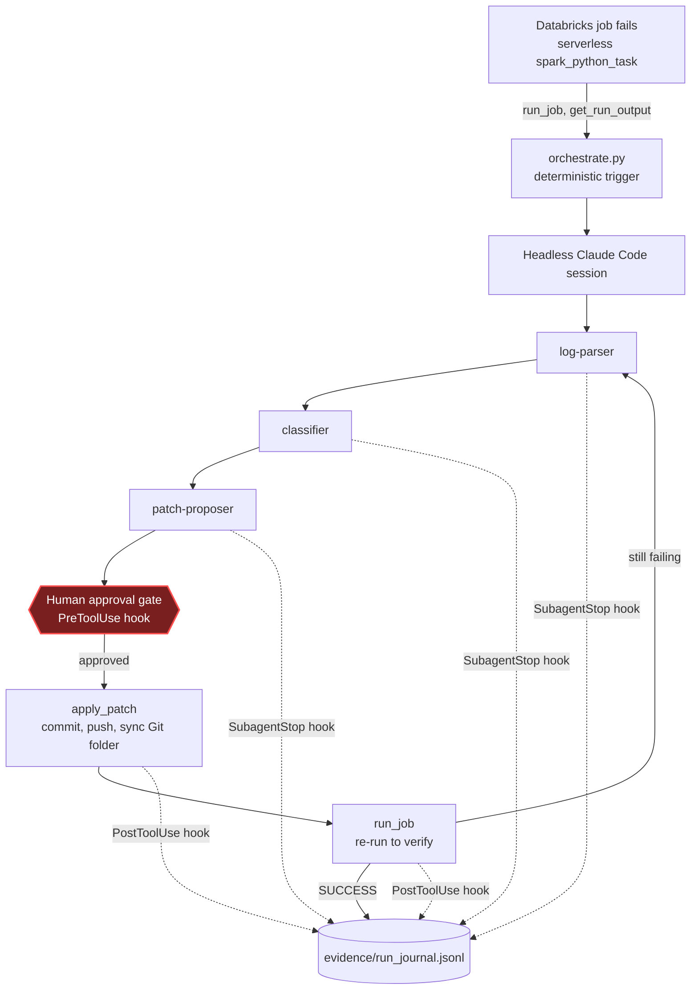
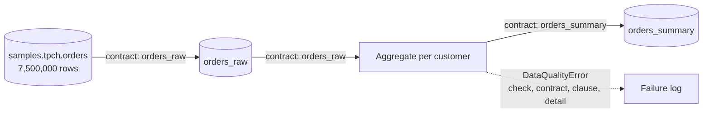
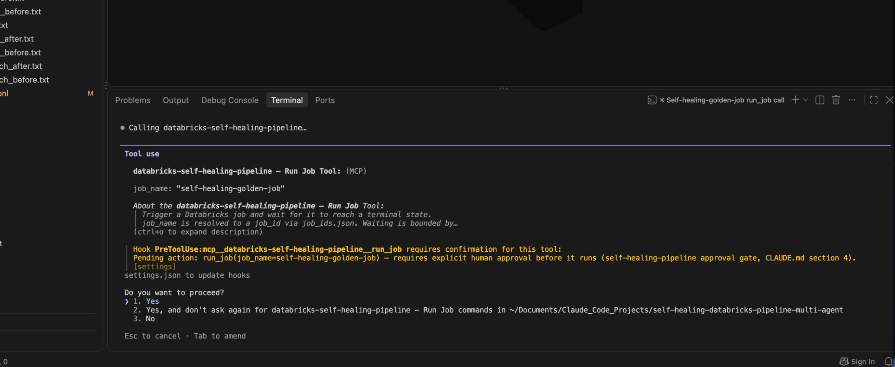
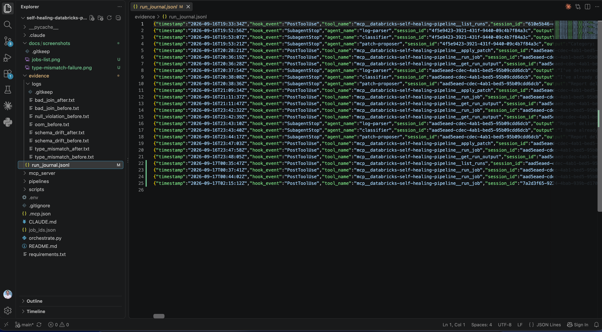

<div align="center">

# 🩺 Self-Healing Databricks Pipeline

**When a Databricks job fails, three Claude agents find the error, classify it, and propose a templated fix.
A person approves every patch and every re-run, and every step is written to an audit journal.**

[](https://github.com/felipecastro-data/self-healing-databricks-pipeline-multi-agent/actions/workflows/ci.yml)


[Why](#-why-this-project) · [Architecture](#-architecture) · [Features](#-features) · [Demo](#-see-it-run) ·
[Results](#-results) · [Decisions](#-architecture-decisions) · [Quickstart](#-quickstart) · [Author](#-author--certifications)

</div>

---

## 💡 Why this project

A failed Spark job leaves a long log, and most of it is noise. An LLM can read that log quickly, but an LLM that can also change code and re-run jobs will sometimes apply a fix that looks right and isn't. In this project that happened twice: one patch only renamed the exception, and another used a cast Spark doesn't support. Both were valid code, and neither fixed the job.

So the system is deliberately narrow. The agents can only read and propose, and a person decides what happens next:

| | Step | What happens |
|---|---|---|
| 🚨 | **Trigger** | [`orchestrate.py`](src/self_healing/orchestrate.py) runs a named job and, if it fails, fetches the raw output. |
| ✂️ | **Parse** | `log-parser` reduces the log to the exception, the frames in pipeline code, and the identifiers. |
| 🏷️ | **Classify** | `classifier` maps the excerpt to one of five known categories, or `unclassified`, and cites the violated contract clause. |
| 🩹 | **Propose** | `patch-proposer` fills in that category's fix template with names taken from the log. |
| ✋ | **Approve** | A `PreToolUse` hook stops `apply_patch` and `run_job` until a person says yes. |
| 🔁 | **Verify** | The job is re-run. If it still fails, the new failure goes back through the chain. |
| 📓 | **Record** | Hooks append every tool result and agent completion to [`evidence/run_journal.jsonl`](evidence/run_journal.jsonl). |

**The failure taxonomy**

| Category | Log signature | Template fix |
|---|---|---|
| `schema_drift` | `AnalysisException`, column not found, type mismatch on read, `DataQualityError` with `check=expected_columns` | Explicit schema or `mergeSchema` |
| `null_violation` | NOT NULL violated, null in a non-nullable write, `DataQualityError` with `check=not_null` | `.na.drop()` or `.fillna()` on the column |
| `oom` | Exit code 137 with no traceback, "Execution ran out of memory", `OutOfMemoryError`, executor lost | Repartition, or a broadcast join |
| `bad_join` | Row explosion, duplicate keys, Cartesian product, `DataQualityError` with `check=unique_key` or `check=row_count_ratio` | Validate key uniqueness, switch join type |
| `type_mismatch` | Cannot resolve, implicit cast error | Explicit `.cast()` on the column |

---

## 🧱 Architecture



`orchestrate.py` diagnoses a single named job each time it's run; it doesn't poll on a schedule. It never applies a patch or re-runs a job. The headless session blocks both tools outright, because no person is present to answer the approval prompt. Applying and verifying are separate steps in an interactive Claude Code session.

### Where the data contracts sit



### Code

| Path | What it does |
|---|---|
| [`src/self_healing/orchestrate.py`](src/self_healing/orchestrate.py) | The trigger: runs a job and hands a failure to the agent chain. |
| [`src/self_healing/mcp/`](src/self_healing/mcp) | MCP server with `list_runs`, `get_run_output`, `apply_patch` and `run_job`. |
| [`src/self_healing/jobs/`](src/self_healing/jobs) | Ingestion, the golden job, contract validation, typed checks, JSON logging. |
| [`src/self_healing/jobs/broken_scenarios/`](src/self_healing/jobs/broken_scenarios) | Six jobs that each inject one defect. |
| [`src/self_healing/journal.py`](src/self_healing/journal.py) | Builds the results report from the evidence files. |
| [`src/databricks_entry.py`](src/databricks_entry.py) | Single entry point that passes the injected `spark` session to a job's `run()`. |
| [`.claude/agents/`](.claude/agents) | The three agents, each limited to the `Read` tool and a strict output format. |
| [`.claude/hooks/`](.claude/hooks) | The approval gate and the two evidence loggers. |
| [`contracts/`](contracts) | YAML data contracts for `orders_raw` and `orders_summary`. |
| [`databricks.yml`](databricks.yml) | All eight jobs, with `dev` and `prod` targets. |

---

## ✨ Features

### ✋ Approval before anything changes

The gate is a hook, not an instruction to the model, so it applies whatever the model decides. The hook's message names the file or job involved. It covers only `apply_patch` and `run_job`, the two tools that change something.

### 📜 Contract breaches, not bare assertions

Jobs validate against YAML contracts before writing, and raise a typed `DataQualityError`. The classifier cites the clause that was broken, so a failure points at a named rule:

```
check=not_null contract=orders_summary clause=columns.total_value.not_null detail=null_rows=2521
```

| Clause | What it enforces |
|---|---|
| `columns.<name>.present` | The column exists |
| `columns.<name>.type` | The column has the declared type |
| `columns.<name>.not_null` | The column has no nulls |
| `primary_key.unique` | The key has no duplicates |
| `join_key.<name>.unique` | A join key is unique on its side of the join |
| `row_count.max_ratio` | A join didn't multiply the rows beyond a limit |

### 🧩 Fixed templates, not free-form code

`patch-proposer` can only fill in one of five templates. If the classifier doesn't get a clean match, the answer is `unclassified`, with no best guess.

### 🔧 `apply_patch` refuses to guess

| Guard | Refuses when |
|---|---|
| Path check | The file resolves outside the repo, or doesn't exist |
| Exact match | The old snippet matches zero times, or more than once |
| Sync check | The workspace Git folder doesn't reach the new commit (raises instead of reporting success) |

### 🧮 Model output is parsed by code

The classifier is told to follow a strict format, and sometimes hasn't. The report extracts the category with a regex and shows `unparsed` when it can't, so nothing depends on the model formatting its reply perfectly.

### 🛡️ Evidence with identifiers removed

Hooks redact the workspace host and user path before anything reaches the journal. Run durations are kept in [`evidence/run_history.json`](evidence/run_history.json), because the Jobs API keeps runs for only 60 days.

---

## 🎬 See it run

The `type_mismatch` scenario shows why the gate exists. It compares `o_totalprice` (`DECIMAL(18,2)`) with `o_orderdate` (`DATE`).

**Round 1: the right category and a wrong patch.** The classifier returned `type_mismatch`, and `patch-proposer` proposed a direct cast:

```diff
- F.col("o_totalprice") == F.col("o_orderdate"),
+ F.col("o_totalprice") == F.col("o_orderdate").cast("decimal(18,2)"),
```

The patch was approved and applied, and the re-run failed with a new error:

```
[DATATYPE_MISMATCH.CAST_WITH_FUNC_SUGGESTION] Cannot resolve "CAST(o_orderdate AS DECIMAL(18,2))"
due to data type mismatch: cannot cast "DATE" to "DECIMAL(18,2)".
```

**Round 2: the new failure went back through the chain.** The second patch stayed inside the same template, chaining supported casts:

```diff
- F.col("o_totalprice") == F.col("o_orderdate").cast("decimal(18,2)"),
+ F.col("o_totalprice") == F.col("o_orderdate").cast("timestamp").cast("long").cast("decimal(18,2)"),
```

The re-run succeeded ([before](evidence/logs/type_mismatch_before.txt), [after](evidence/logs/type_mismatch_after.txt)). The comparison is a contrived defect, so the fix shows the loop working rather than a meaningful business rule.

**A contract breach, end to end** (2026-11-09, from the saved [run output](evidence/logs/null_violation_contract_before.txt)):

```
Classification: null_violation
Matched signature: `DataQualityError` with `check=not_null`
Contract clause: columns.total_value.not_null
```

The proposed fix was `.na.drop(subset=["total_value"])`, chosen over `.fillna()` because a filled amount would be invented. It hasn't been applied.

**The approval gate**



**The evidence journal** (captured in September, before the code moved to `src/`)



---

## 📈 Results

The [full report](docs/results.md) is generated by `make report` from the journal and the run history.

**Source data.** `orders_raw` is 7,500,000 rows copied from the public `samples.tpch.orders` table by [`ingest_orders_raw`](src/self_healing/jobs/ingest_orders_raw.py) (64 s). Runs up to 2026-09-17 used a 5,000-row table, and the runs on 2026-11-09 used the full table.

| Scenario | Diagnosis | Failing run | First successful run | Latest run (7.5M rows) | Status |
|---|---:|---:|---:|---|---|
| `type_mismatch` | 25 s, then 42 s | 52 s | 66 s | SUCCESS, 30 s | ✅ Fixed, took two patches |
| `schema_drift` | 67 s | 39 s | 36 s | SUCCESS, 37 s | ✅ Fixed, took two patches |
| `bad_join` | not journaled | 43 s | 71 s | SUCCESS, 37 s | ✅ Fixed |
| `contract_drift` | 82 s, then 61 s | 60 s | n/a | FAILED, 60 s (by design) | 🔎 Diagnosed, not applied |
| `null_violation` | 18 s | 90 s (5,000 rows) | n/a | FAILED, 61 s (by design) | 🔎 Diagnosed, not applied |
| `oom` | not journaled | 812 s (5,000 rows) | n/a | not re-run | 🔎 Diagnosed earlier, not applied |

Failing and first successful runs are from the 5,000-row table, except `contract_drift`, which only exists at 7.5 million rows. The golden job took 39 s at 7.5 million rows.

**How much a round uses.** About 27,000 to 29,000 tokens across the three agents. The agents' own working time was 16 s and 22 s in the last two rounds. See the [design notes](docs/design.md#cost) for the breakdown.

**How to read these numbers**

- **Runtimes don't show the fixes made jobs faster.** The same golden job took between 22 and 62 s across 5 runs on 5,000 rows, so differences of this size are noise.
- **Diagnosis time includes waiting.** It runs from log-parser finishing to patch-proposer finishing, in interactive sessions where agents were started by hand. It's an upper bound on the agents' time.
- **The report's counts cover only what's journaled.** It shows 8 rounds, 3 patches applied and 2 verified. The journal started on 2026-09-16, after the `bad_join` fix (15 September) and the first `schema_drift` patch, so those aren't counted.
- **Rounds aren't separate incidents.** `contract_drift` and `null_violation` were each diagnosed more than once from the same saved failure.
- **Three rounds show `unparsed`,** because the agents ended with a hand-back tool call and the hook logged either nothing or a "report delivered" note. The hook now reads the agent transcript. Rows already written were left as they were.
- **Repeating a round can give a different patch.** Two `contract_drift` rounds produced different renames. Only the classification was stable, and neither patch was run.
- **Accuracy isn't measured.** Six scenarios, each with a known injected defect, are a demonstration and not an estimate of how this performs on real failures.
- **Older evidence cites old paths.** Logs and journal rows from September refer to `pipelines/...` and `mcp_server/...`, from before the code moved to `src/self_healing/`. They're kept as they were recorded.

---

## 🧭 Architecture decisions

| ADR | Decision |
|---|---|
| [0001](docs/adr/0001-human-approval-gate.md) | Human approval before any patch or re-run |
| [0002](docs/adr/0002-deterministic-extraction-fallback.md) | Extract the classifier's category with a regex |
| [0003](docs/adr/0003-push-whole-branch.md) | `apply_patch` pushes the whole current branch (a known risk) |
| [0004](docs/adr/0004-bundle-jobs-run-from-git-folder.md) | The bundle declares jobs, but they run from the Git folder |

Scale, cost, governance and security limits are written up in the [design notes](docs/design.md).

---

## 🚀 Quickstart

**Prerequisites**

- A [Databricks Free Edition](https://www.databricks.com/learn/free-edition) workspace with the `samples` catalog, and a personal access token
- A Unity Catalog catalog named `self_healing_demo`
- A workspace Git folder pointing at your fork of this repo
- The [Databricks CLI](https://docs.databricks.com/dev-tools/cli/install.html), [Claude Code](https://code.claude.com/docs) and Python 3.11+

**Run**

```bash
cp .env.example .env    # fill in DATABRICKS_HOST, DATABRICKS_TOKEN, DATABRICKS_GIT_FOLDER
make setup              # create venv/, deploy the jobs to dev, ingest orders_raw
make demo JOB=self-healing-contract-drift
```

`make demo` runs the job, sends a failure through the three agents, prints the proposed patch and stops. To apply it, open `claude` in the repo and ask it to call `apply_patch` and then `run_job`. You'll be asked to approve each one.

**Commands**

| Command | What it does |
|---|---|
| `make setup` | Installs, deploys the bundle to dev, ingests `orders_raw` |
| `make deploy [TARGET=prod]` | Validates and deploys the bundle |
| `make ingest` | Rebuilds `orders_raw` |
| `make demo JOB=<name>` | Runs a job and diagnoses a failure |
| `make report` | Snapshots run history and regenerates `docs/results.md` |
| `make test` / `make lint` | Runs pytest / ruff |

On an iCloud-synced folder on macOS, name the environment `venv`, not `.venv`. iCloud marks dot-folders as hidden, and recent Python versions skip hidden `.pth` files, which breaks the editable install.

**Development**

Tests run without credentials: the Spark tests use a local session, which needs Java, and the Databricks and Git calls are mocked. CI runs ruff and pytest on Python 3.12 and 3.14.

```bash
pip install -e ".[dev]"
ruff check .
pytest
```

**Deployment.** [`deploy.yml`](.github/workflows/deploy.yml) validates and deploys to `dev` on every push to `main`, and `prod` waits for approval on a GitHub `prod` environment. It stays inactive until the repository has the secrets `DATABRICKS_HOST` and `DATABRICKS_TOKEN` and the variables `DATABRICKS_GIT_FOLDER` and `DATABRICKS_GIT_FOLDER_PROD`.

### Known limitations

- **Not everything has run end to end.** The jobs and contracts ran on Databricks, and the MCP server and each agent ran for real. `make demo` hasn't been run on the current code. `deploy.yml` has never run, and the `prod` target has been validated but never deployed.
- **`oom` wasn't re-run at 7.5 million rows.** The job is unbounded on purpose and now has a 15-minute timeout. Its log signature also depends on the environment.
- **One job at a time, triggered by hand.** See the [design notes](docs/design.md#scalability) for what continuous detection would need.
- **`apply_patch` can edit any file in the repo and pushes the whole branch.** The approval gate is the only control over which file it touches.
- **Free Edition serverless only.** Behaviour that depends on cluster configuration doesn't apply.

<details>
<summary><b>Repository layout</b></summary>

```
src/
  databricks_entry.py     entry point for every Databricks job
  self_healing/
    orchestrate.py        trigger for the agent chain
    journal.py            results report from the evidence files
    mcp/                  MCP server and its four tools
    jobs/                 ingestion, golden job, contracts, checks, JSON logging
      broken_scenarios/   six jobs with one injected defect each
contracts/                YAML data contracts
.claude/agents/           log-parser, classifier, patch-proposer
.claude/hooks/            approval gate and evidence loggers
evidence/                 run journal, run history, before and after logs
docs/                     design notes, ADRs, results, screenshots
tests/                    checks, contracts, jobs, apply_patch, journal, safety hooks
scripts/                  run-history snapshot
databricks.yml            job definitions with dev and prod targets
Makefile                  setup, deploy, ingest, demo, report, test, lint
```

</details>

---

## 🏅 Author & Certifications

**Felipe Castro**<br>
Senior Data Engineer @ EPAM Systems<br>
[GitHub](https://github.com/felipecastro-data) · [LinkedIn](https://www.linkedin.com/in/felipecastro-data/)

- 🏅 **[DP-700: Microsoft Certified: Fabric Data Engineer Associate](https://learn.microsoft.com/api/credentials/share/en-us/FelipeCastro-8026/96572499DF943EBC?sharingId=13D660F56C1DFFA3)**
- 🏅 **[DP-600: Microsoft Certified: Fabric Analytics Engineer Associate](https://learn.microsoft.com/api/credentials/share/en-us/FelipeCastro-8026/6C5A2F5A8A5864FC?sharingId=13D660F56C1DFFA3)**
- 🏅 **[PL-300: Microsoft Certified: Power BI Data Analyst Associate](https://learn.microsoft.com/api/credentials/share/en-us/FelipeCastro-8026/F853AABE365874B3?sharingId=13D660F56C1DFFA3)**

---

## 🧰 Tools & Tech


---

The data is the public TPC-H sample from `samples.tpch`, which is generated rather than real business data.
